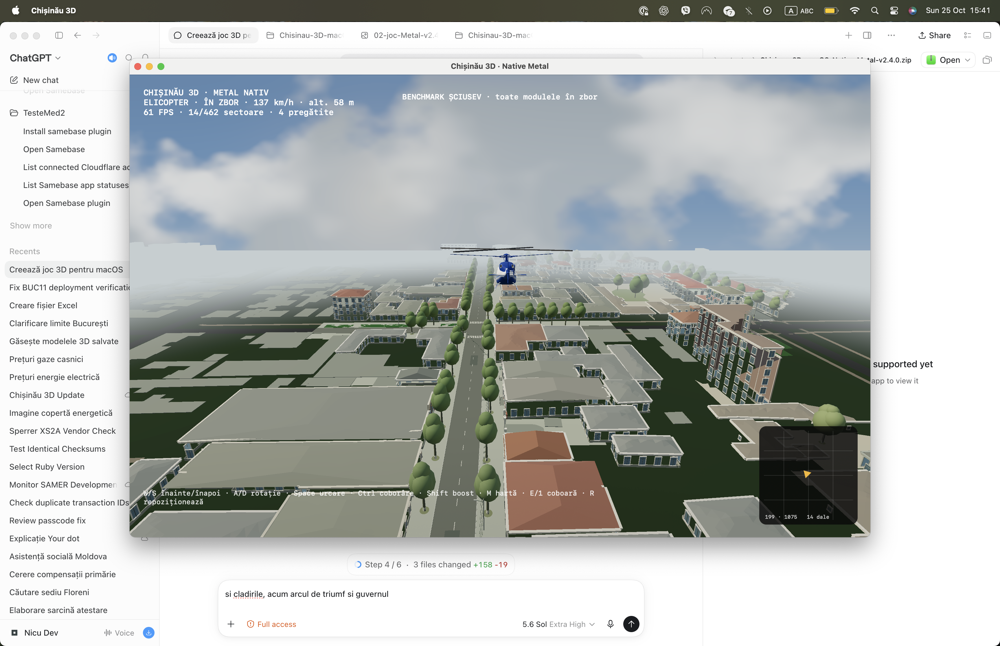

# Chișinău 3D · Native Metal pentru macOS

Joc open-world 3D al centrului Chișinăului, cu motor nativ C++20 / Objective-C++ și Metal. Aplicația livrată nu folosește Electron, Chromium, JavaScript sau conexiune la internet în timpul jocului.

[Descarcă ultima versiune macOS](https://github.com/StefanIGC/chisinau-3d-macos-native/releases/latest)



## Ce conține

- pieton, Toyota Prius și elicopter controlabile;
- generarea unei mașini cu `2` și a unui elicopter cu `3`, în spațiu liber lângă personaj;
- fizică deterministă la 120 Hz pentru vehicule;
- hartă offline, 49 de destinații și teleportare sigură;
- 16 module reconstruite pe strada Șciusev;
- 11 module BUC01–BUC11 pe strada București;
- Columna între Tighina și Ismail;
- arhitectura și suprafețele originale compilate din proiectul de autor;
- Guvernul, Columna Pușkin–Bodoni, Parcul Catedralei, terenul Operei și parcările centrale de biciclete, restaurate din scena online;
- garduri și ziduri, cursuri de apă, aliniamente de arbori, suprafețe de drum, căi ferate și mobilier urban din datele originale;
- modelul 3D detaliat al Teatrului de Operă, cu transformarea exactă din proiect;
- corpuri de clădire închise sub fațadele detaliate, fără golurile produse de eliminarea pereților și acoperișurilor;
- vizibilitate fără fog până la 7 km, cu orașul de bază păstrat la orizont;
- prezentare Metal de până la 120 Hz pe ecranele ProMotion, cu revenire automată la rata ecranului;
- executabil universal Apple Silicon `arm64` + Intel `x86_64`.

## Structură

- `chisinau-native/` — motorul C++/Metal, compilatoarele de dale și auditul;
- `chisinau-macos/` — sursa proiectului 3D de autor, datele și asset-urile necesare compilării;
- `docs/` — capturi, audit și notele verificărilor și lansărilor.

Fișierele generate (`.ctile`, `.dtile`, aplicația și arhivele) nu sunt ținute în Git. Buildul complet este publicat în secțiunea Releases.

## Build nativ

Cerințe: macOS 12+, Xcode Command Line Tools și Node.js 20+.

```sh
cd chisinau-macos
npm ci
cd ../chisinau-native
./build.sh ../chisinau-macos --rebuild-world
```

Rezultatul este:

```text
chisinau-native/build/Chișinău 3D Native/Chișinău 3D.app
```

Compilatorul folosește JavaScript numai pentru conversia datelor și modelelor. Aplicația rezultată este nativă.

## Teste

```sh
BIN="chisinau-native/build/Chișinău 3D Native/Chișinău 3D.app/Contents/MacOS/Chisinau3DNative"
"$BIN" --benchmark
"$BIN" --benchmark-car
"$BIN" --benchmark-columna
"$BIN" --benchmark-sciusev
"$BIN" --benchmark-bucuresti
"$BIN" --test-walker
"$BIN" --test-interaction
"$BIN" --test-map
"$BIN" --test-spawn
```

Pe sistemul de verificare Apple M1 Pro, traseele fără fog Centru, Columna, Șciusev și București și testul mașinii sunt verificate la aproximativ 60 FPS. Vezi [noutățile versiunii 2.13.0](docs/RELEASE-v2.13.0.md) și [auditul lumii](docs/WORLD-AUDIT.json).

## Date și licențe

Datele hărții: © OpenStreetMap contributors, ODbL 1.0. Proiectul include asset-uri cu licențe diferite; consultă [LICENSES.md](LICENSES.md) și `chisinau-macos/ASSETS.md` înainte de redistribuire sau reutilizare. Publicarea repository-ului nu relicențiază automat asset-urile terților.
